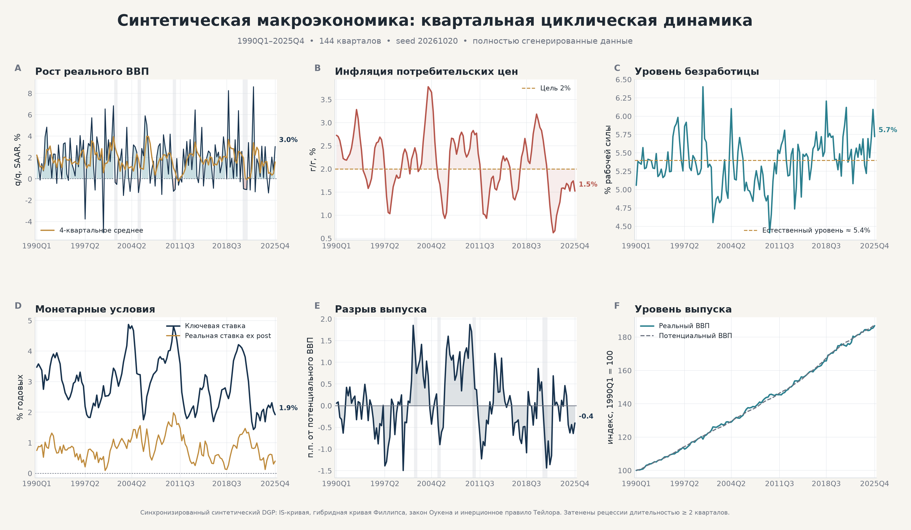
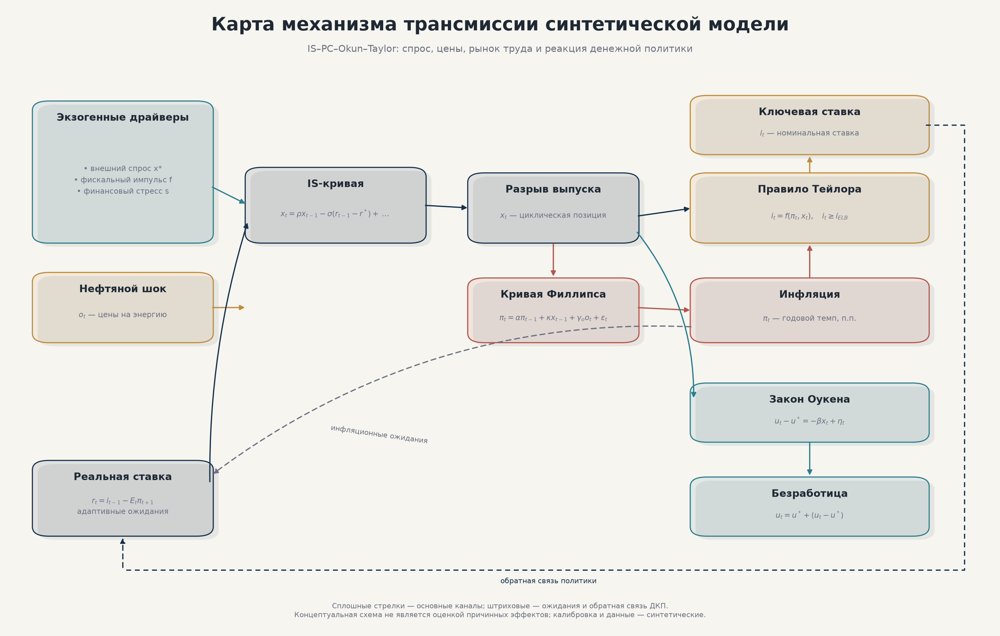
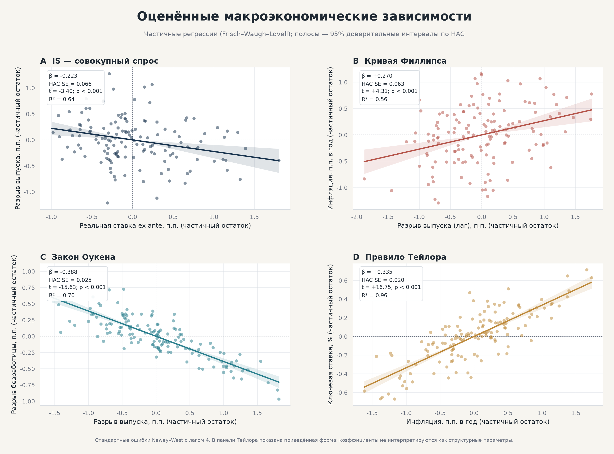
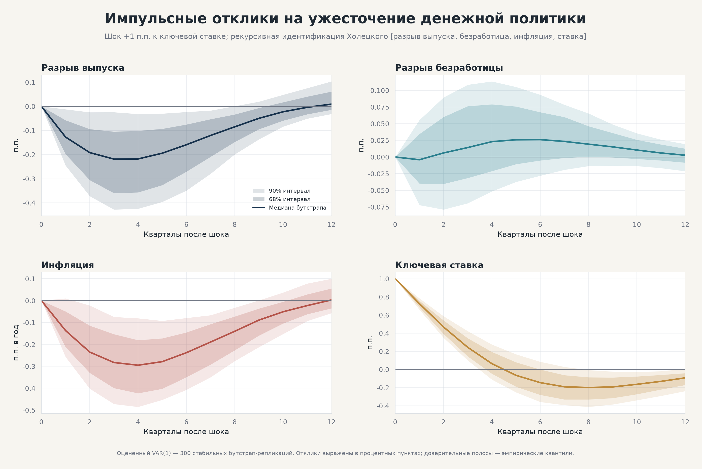
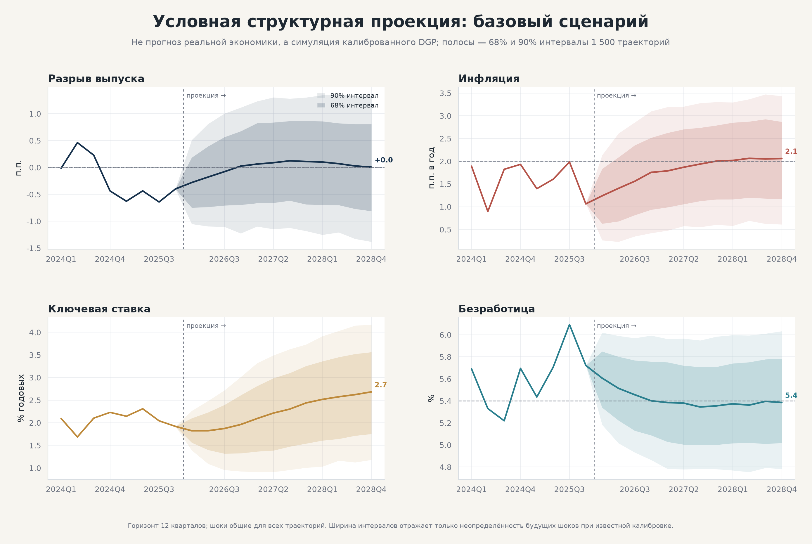
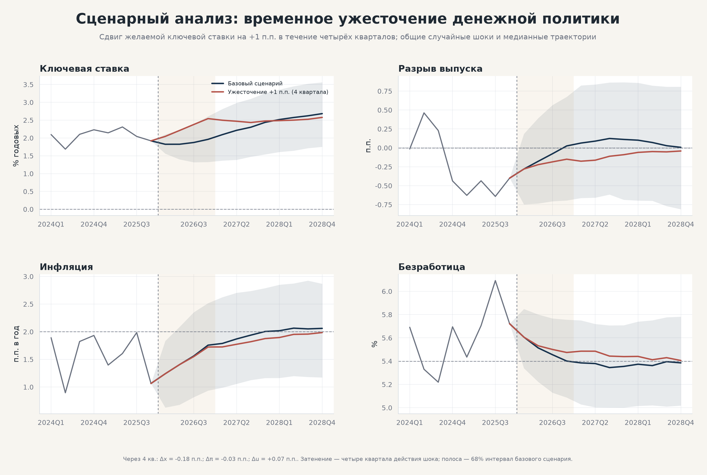
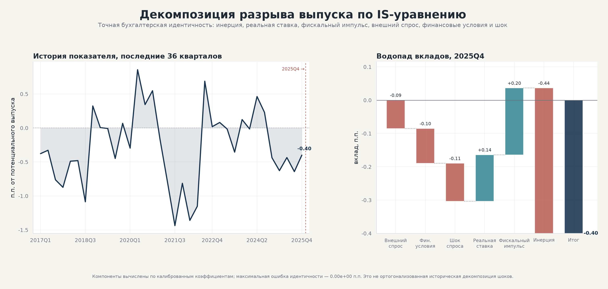
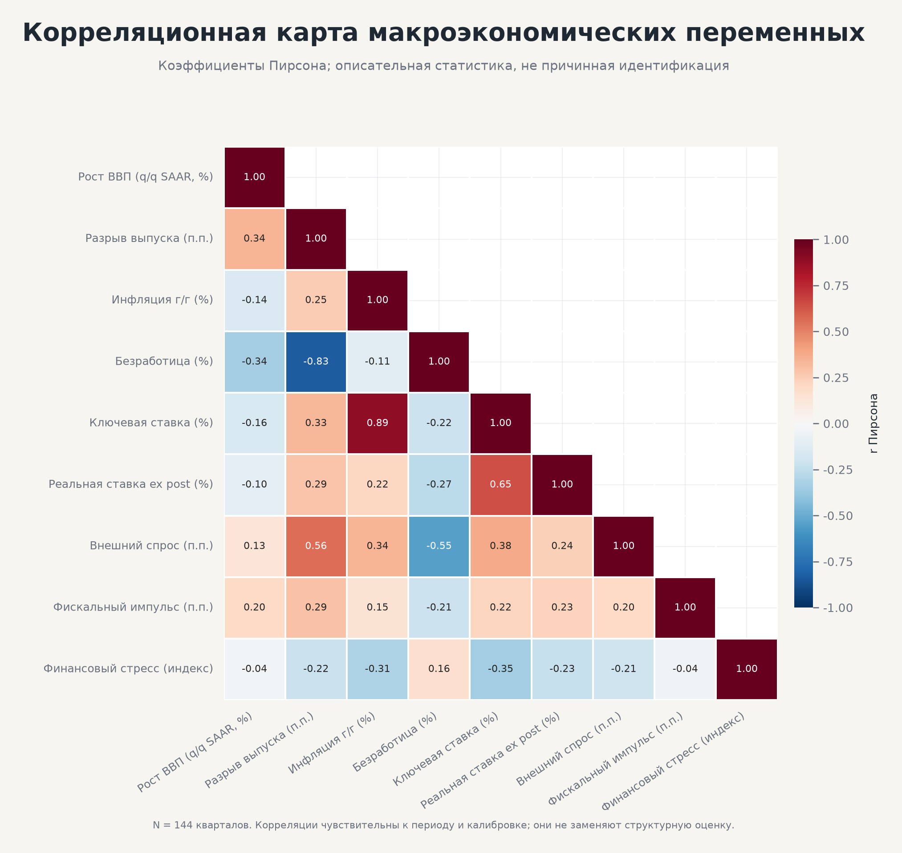

# MacroCanvas

**Синтетическая полуструктурная макроэкономическая лаборатория: генерация данных, эконометрическая оценка и визуальная аналитика**

**Версия 0.1.0** · Python ≥ 3.11 · MIT License · 22 теста · 8 автоматических фигур


> [!IMPORTANT] 
**Проект полностью сгенерирован ИИ моделью - DeepSeekV4.1**


MacroCanvas — это воспроизводимый исследовательский стенд, который последовательно проходит полный аналитический цикл: **симулирует** синтетическую макроэкономику с известным процессом порождения данных (DGP), **оценивает** её поведенческие уравнения и векторную авторегрессию, **строит** условные проекции и контрфактические сценарии, **декомпозирует** динамику выпуска и **оформляет** результаты в публикационно-качественные графики и автоматический Markdown-отчёт.

Все ряды в проекте **полностью синтетические**. Ни одно реальное наблюдение не используется ни на одном шаге пайплайна.

> **Дисклеймер.** MacroCanvas — учебный и исследовательский артефакт. Сгенерированные ряды, оценки, доверительные интервалы и сценарии относятся к калиброванной имитационной модели и **не являются** прогнозом реальной экономики, рекомендацией экономической политики или эмпирическим результатом. Оценки уравнений — reduced-form-аппроксимации известного DGP, а не свидетельства о причинных связях в действительности.

**Дополнительная документация:** [`docs/MODEL.md`](docs/MODEL.md) — полная математическая спецификация и калибровка; [`docs/ARCHITECTURE.md`](docs/ARCHITECTURE.md) — слои, контракты данных и точки расширения.

---

## Содержание

1. [Назначение и принципы проектирования](#1-назначение-и-принципы-проектирования)
2. [Визуальный обзор](#2-визуальный-обзор)
3. [Модель](#3-модель)
4. [Генератор данных](#4-генератор-данных)
5. [Эконометрический контур](#5-эконометрический-контур)
6. [Архитектура и структура проекта](#6-архитектура-и-структура-проекта)
7. [Быстрый старт](#7-быстрый-старт)
8. [Командный интерфейс](#8-командный-интерфейс)
9. [Выходные артефакты](#9-выходные-артефакты)
10. [Результаты baseline-прогона](#10-результаты-baseline-прогона)
11. [Воспроизводимость](#11-воспроизводимость)
12. [Тестирование](#12-тестирование)
13. [Расширение модели](#13-расширение-модели)
14. [Ограничения и методологическая честность](#14-ограничения-и-методологическая-честность)
15. [Литература](#15-литература)
16. [Лицензия](#16-лицензия)
17. [Приложение A. Словарь обозначений](#приложение-a-словарь-обозначений)

---

## 1. Назначение и принципы проектирования

### 1.1. Зачем нужен синтетический стенд

Эмпирическая макроэкономика сталкивается с фундаментальной проблемой: истинный процесс порождения данных ненаблюдаем. Исследователь не знает ни структурных параметров, ни «истинного» разрыва выпуска, ни того, какой из конкурирующих идентификационных подходов ближе к правде. Синтетическая лаборатория переворачивает эту ситуацию: мы **сами задаём** DGP, а затем проверяем, что и как из него извлекают стандартные инструменты — OLS с HAC-инференцией, VAR с рекурсивной идентификацией, сценарные проекции и бухгалтерские декомпозиции.

Такой стенд решает четыре задачи:

1. **Валидация инструментов.** Если оценщик не восстанавливает параметры на данных, где истина известна, ему нельзя доверять на реальных данных.
2. **Демонстрация полного цикла.** От калибровки — через симуляцию — к оценке, сценарному анализу и графическому представлению.
3. **Обучение.** Каждое уравнение модели прослеживается до строки кода; каждое преобразование данных документировано.
4. **Воспроизводимость.** Любая цифра в отчёте воспроизводится одной командой при фиксированном seed.

### 1.2. Принципы

| Принцип | Реализация |
| --- | --- |
| Прозрачность DGP | Каждое уравнение — явный цикл по времени в `data/generator.py`, без скрытых библиотечных абстракций |
| Разделение слоёв | `config → data → models → analytics → viz → reporting`; каждый слой зависит только от предыдущих |
| Отсутствие магии | OLS и VAR реализованы на NumPy/pandas вручную; нет «чёрных ящиков» вроде statsmodels-обёрток |
| Честная инференция | Newey–West HAC для квартальных рядов, residual bootstrap для IRF |
| Контроль случайности | `SeedSequence.spawn(9)` — независимые потоки для каждого шока; общие случайные числа в сценариях |
| Типизированные конфиги | Frozen dataclass'ы с валидацией экономических ограничений; TOML-файл как единственный источник калибровки |
| Самодокументируемость | Автогенерация `analysis_summary.md` и `run_metadata.json` при каждом прогоне |
| Тестируемость | 22 теста: воспроизводимость, идентичности, знаки коэффициентов, стабильность VAR, полнота артефактов |

---

## 2. Визуальный обзор

Ниже — восемь итоговых графиков baseline-прогона. Все они генерируются автоматически и лежат в `reports/figures/` (копии — в `docs/images/`).

### 2.1. Макроэкономическая панель



Шесть панелей: рост реального ВВП (q/q SAAR с 4-квартальным средним), инфляция г/г с целью 2 %, безработица с естественным уровнем, монетарные условия (ключевая ставка и реальная ставка ex post), разрыв выпуска и уровни выпуска. Серые вертикальные полосы — рецессии длительностью ≥ 2 кварталов, определённые по отрицательному квартальному росту.

### 2.2. Карта механизма трансмиссии



Стилизованная блок-схема IS–PC–Okun–Taylor: экзогенные драйверы (внешний спрос, фискальный импульс, финансовый стресс, нефтяной шок) → IS-кривая → разрыв выпуска → кривая Филлипса и закон Оукена → правило Тейлора с нижней границей → обратная связь на реальную ставку.

### 2.3. Оценённые зависимости



Четыре частичные регрессии (Frisch–Waugh–Lovell): IS-кривая, кривая Филлипса, закон Оукена, правило Тейлора. Точки — данные, очищенные от остальных регрессоров; наклон линии точно равен коэффициенту множественной регрессии; полоса — 95 % доверительный интервал по HAC-ошибкам.

### 2.4. Импульсные отклики на денежный шок



Отклики VAR(1) на ортогонализованный шок +1 п.п. к ключевой ставке при рекурсивной идентификации Холецкого с упорядочением `[разрыв выпуска, разрыв безработицы, инфляция, ставка]`. Полосы — эмпирические квантили 68 % и 90 % residual-bootstrap-распределения (300 стабильных репликаций).

### 2.5. Условная структурная проекция



Базовый сценарий на 12 кварталов: 1 500 траекторий, стартующих из терминального состояния синтетической экономики. Ширина веера отражает **только** неопределённость будущих шоков при известной калибровке — это не прогноз и не байесовский апостериор.

### 2.6. Сценарий ужесточения денежной политики



Контрфактическое сравнение: желаемая ключевая ставка временно повышена на +1 п.п. на четыре квартала. Общие случайные числа (common random numbers) гарантируют, что разность траекторий изолирует эффект интервенции, а не разницу в шоках.

### 2.7. Декомпозиция разрыва выпуска



Слева — история разрыва выпуска за 36 кварталов; справа — водопад точной бухгалтерской декомпозиции IS-уравнения за последний квартал: инерция, реальная ставка, фискальный импульс, внешний спрос, финансовые условия и шок спроса. Компоненты складываются в наблюдаемый разрыв с численной ошибкой 0.00e+00 п.п.

### 2.8. Корреляционная карта



Матрица парных корреляций Пирсона девяти ключевых переменных. Инструмент описательной диагностики: корреляции чувствительны к периоду и калибровке и не заменяют структурную оценку.

---

## 3. Модель

### 3.1. Общая конструкция

Ядро — **полуструктурная** (semi-structural) модель малой открытой экономики квартальной частоты, соединяющая четыре классических блока:

- **IS-кривая** — динамика совокупного спроса;
- **кривая Филлипса** — динамика инфляции;
- **закон Оукена** — связь выпуска и рынка труда;
- **правило Тейлора** — реакция денежной политики.

Модель не является микрофундированной DSGE: коэффициенты заданы напрямую, а не выведены из оптимизационного поведения домохозяйств и фирм. Это сознательный компромисс: полуструктурный DGP воспроизводит ключевые циклические корреляции и при этом остаётся полностью прозрачным для аудита и оценки.

### 3.2. Уравнения

Ниже — полная система в порядке вычисления на каждом квартале `t`.

**(1) Адаптивные ожидания инфляции**

```
πᵉₜ = ω·π* + (1 − ω)·πₜ₋₁,            ω = 0.35
```

Ожидания — выпуклая комбинация цели π* и фактической инфляции прошлого квартала: частично заякоренные, частично адаптивные. Это простейшая параметризация гибридных ожиданий без рациональных прогнозов.

**(2) Реальная ставка ex ante**

```
rᵉₜ = iₜ₋₁ − πᵉₜ
```

Реальная ставка наследуется от прошлого решения по политике, что исключает одновременность в реальном блоке.

**(3) IS-кривая (совокупный спрос)**

```
xₜ = ρₓ·xₜ₋₁ − σᵣ·(rᵉₜ − r*) + δ_f·fₜ + δ_{x*}·x*ₜ − δ_s·sₜ + εˣₜ
```

| Параметр | Значение | Смысл |
| --- | --- | --- |
| ρₓ | 0.68 | инерция разрыва выпуска |
| σᵣ | 0.20 | чувствительность к реальной ставке |
| δ_f | 0.18 | эффект фискального импульса |
| δ_{x*} | 0.12 | эффект внешнего спроса |
| δ_s | 0.12 | эффект финансового стресса |
| r* | 0.75 | нейтральная реальная ставка |
| σ(εˣ) | 0.45 | стандартное отклонение шока спроса |

**(4) Кривая Филлипса**

```
πₜ = π* + α·(πₜ₋₁ − π*) + κ·xₜ₋₁ + γ_o·oₜ + ε^πₜ
```

| Параметр | Значение | Смысл |
| --- | --- | --- |
| π* | 2.0 | цель по инфляции |
| α | 0.58 | инерция инфляции |
| κ | 0.25 | наклон по прошлому разрыву выпуска |
| γ_o | 0.015 | перенос нефтяного шока |
| σ(ε^π) | 0.60 | стандартное отклонение шока цен |

Инфляция измеряется в **годовых** процентных пунктах при квартальной частоте; лаг выпуска в правой части убирает одновременность.

**(5) Закон Оукена**

```
ηₜ = ρ_η·ηₜ₋₁ + ε^uₜ                 (серийно коррелированный остаток рынка труда)
uᵍᵃᵖₜ = −β·xₜ + ηₜ
uₜ = u* + uᵍᵃᵖₜ
```

| Параметр | Значение | Смысл |
| --- | --- | --- |
| u* | 5.4 | естественная безработица, % |
| β | 0.42 | коэффициент Оукена |
| ρ_η | 0.50 | персистентность остатка |
| σ(ε^u) | 0.15 | стандартное отклонение шока |

**(6) Правило Тейлора с нижней границей**

```
iᵈᵉˢₜ = r* + π* + φ_π·(πₜ − π*) + φ_x·xₜ
iₜ = max{ i_ELB,  ρ_i·iₜ₋₁ + (1 − ρ_i)·iᵈᵉˢₜ + ε^iₜ }
```

| Параметр | Значение | Смысл |
| --- | --- | --- |
| ρ_i | 0.78 | инерция политики (сглаживание) |
| φ_π | 1.45 | реакция на инфляцию (> 1 — принцип Тейлора) |
| φ_x | 0.55 | реакция на разрыв выпуска |
| i_ELB | 0.25 | эффективная нижняя граница, % |
| σ(ε^i) | 0.18 | стандартное отклонение шока политики |

**(7) Экзогенные AR(1)-процессы**

```
x*ₜ = 0.82·x*ₜ₋₁ + εˣ*ₜ,      σ = 0.90      внешний спрос
fₜ  = 0.55·fₜ₋₁  + εᶠₜ,       σ = 0.45      фискальный импульс
oₜ  = 0.65·oₜ₋₁  + εᵒₜ,       σ = 4.50      нефтяной шок
sₜ  = 0.82·sₜ₋₁  + εˢₜ,       σ = 0.20      финансовый стресс
gᵖᵒᵗₜ = 1.80 + 0.70·(gᵖᵒᵗₜ₋₁ − 1.80) + εᵍₜ,  σ = 0.25   рост потенциала
```

Каждый процесс стартует из своего безусловного распределения, поэтому отдельный «разогрев» для AR(1)-блоков не требуется.

**(8) Потенциальный и фактический выпуск**

```
log Y*ₜ = log Y*ₜ₋₁ + gᵖᵒᵗₜ / 400
log Yₜ  = log Y*ₜ + xₜ / 100
```

Потенциальный выпуск — стохастический тренд; фактический встраивает разрыв. Деление на 400 переводит годовой темп в квартальный логарифмический прирост.

**(9) Производные ряды**

| Ряд | Формула | Комментарий |
| --- | --- | --- |
| `gdp_growth` | 400·Δ log Yₜ | квартальный рост, SAAR % |
| `price_index` | 100·exp(Σ ln(1 + π/400)) | индекс цен из квартальной инфляции |
| `inflation_yoy` | 4-квартальное изменение индекса | инфляция г/г, % |
| `real_policy_rate` | iₜ − πᵧₒᵧ | реальная ставка ex post |
| `unemployment` | u* + uᵍᵃᵖ | уровень безработицы, % |
| `recession` | 1{gdp_growth < 0} | индикатор рецессии |

### 3.3. Единицы измерения

| Переменная | Единица | Диапазон baseline |
| --- | --- | --- |
| Разрыв выпуска x | п.п. от потенциального выпуска | −1.5 … +1.9 |
| Инфляция π (квартальная, SAAR) | п.п. в год | 0.6 … 3.8 (г/г) |
| Безработица u | % рабочей силы | 4.4 … 6.4 |
| Ключевая ставка i | % годовых | 1.4 … 4.9 |
| Внешний спрос, фискальный импульс, стресс | модельные п.п. | — |

### 3.4. Свойства модели

- **Стабильность реального блока.** При ρₓ = 0.68 и σᵣ = 0.20 система с обратной связью «ставка → спрос → инфляция → ставка» затухает; эмпирическое подтверждение — максимальный модуль корня companion-матрицы VAR 0.844 < 1.
- **Принцип Тейлора.** φ_π = 1.45 > 1 обеспечивает стабилизирующую реакцию политики на инфляцию.
- **Нижняя граница.** ELB = 0.25 % встроена в правило, но в baseline **не связывает**: минимальная наблюдённая ставка — 1.43 %. Это страховочный механизм для конфигураций с глубокой дефляцией или спадом.
- **Асимметрия цикла.** Редкие глубокие спады порождаются финансовым стрессом; ELB добавляет асимметрию только там, где ставка действительно достигает границы.

---

## 4. Генератор данных

### 4.1. Алгоритм

```
вход: seed, periods = 144, burn_in = 60, параметры
n_total ← burn_in + periods

1. Разветвить SeedSequence(seed) на 9 независимых потоков ГПСЧ
2. Сгенерировать 4 белых шума:      εˣ, ε^π, ε^u, ε^i
3. Сгенерировать 5 AR(1)-процессов: x*, f, o, s, gᵖᵒᵗ
4. Для t = 0 … n_total−1:
     πᵉₜ → rᵉₜ → xₜ → πₜ → ηₜ → uᵍᵃᵖₜ → iₜ → Y*ₜ, Yₜ
5. Отбросить первые burn_in наблюдений
6. Назначить PeriodIndex 1990Q1 … 2025Q4
7. Пересчитать производные ряды; ребейзить индексы к 100
выход: DataFrame (144 × 24) + DataFrame шоков (144 × 9)
```

### 4.2. Управление случайностью

Один корневой `SeedSequence(20261020)` разветвляется на девять дочерних потоков через `spawn(9)`. Это даёт три важных свойства:

1. **Изоляция.** Добавление нового шока в модель не сдвигает все существующие случайные розыгрыши — прежние потоки сохраняют свои значения.
2. **Полная воспроизводимость.** Один и тот же seed даёт побитово идентичные ряды (проверяется тестом `test_same_seed_is_reproducible`).
3. **Диагностируемость.** Структурные инновации сохраняются отдельным файлом `data/raw/structural_shocks.csv` — можно сопоставить любой всплеск в данных с его источником.

### 4.3. Разогрев (burn-in)

Первые 60 кварталов отбрасываются. Это устраняет влияние начальных условий (нулевой разрыв выпуска, инфляция на цели, ставка на нейтральном уровне) и гарантирует, что сохраняемая выборка находится на эргодическом участке процесса. Производные ряды (рост, инфляция г/г, реальная ставка) считаются на полной траектории, поэтому первое сохранённое наблюдение уже имеет полную историю.

### 4.4. Контроль качества

- **Точная бухгалтерская идентичность.** Проверяется, что сумма компонентов IS-уравнения совпадает с наблюдаемым разрывом выпуска с численной ошибкой `0.00e+00` (тест `test_accounting_identity_is_exact`).
- **Валидация единиц.** Инфляция г/г близка к цели, безработица колеблется вокруг 5.4 %, ставка не опускается ниже ELB (тест `test_units_and_indicators`).
- **Отсутствие NaN.** Все производные ряды не содержат пропусков в сохранённой выборке.

---

## 5. Эконометрический контур

Оценка намеренно использует только NumPy и pandas — никаких скрытых библиотечных реализаций. Это позволяет проверить каждую формулу и служит учебным дополнением к DGP.

### 5.1. OLS с Newey–West HAC-инференцией

Четыре поведенческих уравнения оцениваются методом наименьших квадратов:

| Уравнение | Зависимая | Регрессоры | Фокус-коэффициент |
| --- | --- | --- | --- |
| IS | xₜ | xₜ₋₁, rᵉₜ, fₜ, x*ₜ, sₜ | σᵣ (ожидается < 0) |
| Филлипса | πₜ | πₜ₋₁, xₜ₋₁, oₜ | κ (ожидается > 0) |
| Оукена | uᵍᵃᵖₜ | xₜ | β (ожидается < 0) |
| Тейлора | iₜ | iₜ₋₁, πₜ, xₜ | φ_π (ожидается > 0) |

Ковариационная матрица оценивается по формуле Ньюи–Уэста с ядром Бартлетта:

```
V̂ = (X'X)⁻¹ · Ŝ · (X'X)⁻¹ · n/(n−k)
Ŝ = Σₜ sₜsₜ' + Σ_{l=1}^{L} w_l · Σₜ (sₜsₜ₋ₗ' + sₜ₋ₗsₜ'),   w_l = 1 − l/(L+1)
sₜ = xₜ · eₜ   (вклад наблюдения в градиент)
```

где `L = 4` (лаг HAC), `n` — число наблюдений, `k` — число параметров. Поправка `n/(n−k)` согласует HAC-оценку с классической дисперсией остатков. Двусторонние p-значения вычисляются через `erfc(|t|/√2)` без обращений к таблицам распределения.

**Почему HAC важен.** Квартальные макроряды имеют автокоррелированные остатки (см. таблицу диагностики: ACF(1) остатков Оукена = 0.45). Классические стандартные ошибки в такой ситуации смещены вниз, а t-статистики завышены.

### 5.2. Частичные регрессии (Frisch–Waugh–Lovell)

Для визуализации каждой связи используется теорема Фриша–Уо–Ловелла: остаток зависимой переменной после проекции на все контроли (включая константу) регрессируется на остаток фокус-регрессора. Наклон этой парной регрессии **точно** равен коэффициенту множественной регрессии — это проверяется тестом `test_partial_regression_slope_matches_multiple_regression`. Графики панели 2.3 показывают именно эти остатки, что делает визуальную связь честной: она не содержит влияния остальных регрессоров.

### 5.3. VAR и импульсные отклики

**Спецификация.** VAR(1) по вектору `[output_gap, unemployment_gap, inflation, policy_rate]`, оценённый поэквеционно OLS.

**Идентификация.** Рекурсивная схема Холецкого с упорядочением `[x, uᵍᵃᵖ, π, i]`:

```
uₜ = Σ εₜ,  Σ = PP',  P — нижняя треугольная (Холецкий)
```

Экономическая логика упорядочения: реальные величины и цены реагируют на политику с лагом (внутри квартала — не реагируют), центральный банк реагирует на макроэкономику contemporaneously. Шок нормализуется так, чтобы мгновенный отклик ставки равнялся ровно +1 п.п.

**Бутстрап.** Каждая из 300 репликаций: (i) рекурсивно симулирует VAR из наблюдаемой начальной истории, (ii) ресэмплирует **целые** векторы остатков (сохраняя кросс-уравнения корреляцию), (iii) переоценивает VAR, (iv) отбрасывается, если новая система нестабильна или даёт нефинитные Σ. Полосы — эмпирические квантили 5/16/50/84/95 %.

**Стабильность.** Companion-матрица имеет максимальный модуль корня 0.844 — система стабильна, IRF затухают.

### 5.4. Структурные проекции и сценарии

Два режима, оба используют **сам DGP**, а не оценённую VAR:

1. **Базовая проекция.** 1 500 траекторий на 12 кварталов из терминального состояния выборки; будущие шоки разыгрываются из калиброванных распределений. Веерные полосы — квантили 5/16/50/84/95 %.
2. **Сценарий ужесточения.** Желаемая ставка сдвигается на +1 п.п. на четыре квартала: `iᵈᵉˢₜ ← iᵈᵉˢₜ + offsetₕ`, где `offsetₕ = 1` при `h ≤ 4` и `0` иначе. Оба сценария используют **одни и те же розыгрыши шоков** (common random numbers), поэтому разность медиан изолирует эффект интервенции.

Разность траекторий — это модельный контрфактический эффект при известной калибровке, а не причинная оценка в реальных данных.

### 5.5. Декомпозиция разрыва выпуска

Так как разрыв выпуска порождается линейным уравнением с известными коэффициентами, его компоненты складываются **точно**:

```
xₜ = ρₓ·xₜ₋₁  −  σᵣ·(rᵉₜ − r*)  +  δ_f·fₜ  +  δ_{x*}·x*ₜ  −  δ_s·sₜ  +  εˣₜ
     ╰────────╯  ╰──────────────╯  ╰───────╯  ╰─────────╯  ╰───────╯  ╰───╯
      инерция      реальная ставка   фискал.    внешний      фин.     шок
```

Водопад в панели 2.7 показывает вклады последнего квартала, упорядоченные по абсолютной величине. Это **бухгалтерская**, а не ортогонализованная историческая декомпозиция: эндогенные компоненты (например, реальная ставка) сами являются результатами модели. Ошибка идентичности печатается прямо на графике и в отчёте.

### 5.6. Диагностика

- **Описательные статистики** — среднее, стандартное отклонение, квартили, минимум/максимум по 12 переменным.
- **Корреляционная матрица** — 9 переменных, диагональ исключена.
- **Рецессионные эпизоды** — последовательные пробеги `gdp_growth < 0` длительностью ≥ 2 кварталов.
- **Остаточная диагностика** — σ остатков и ACF(1) по каждому уравнению.

---

## 6. Архитектура и структура проекта

### 6.1. Дерево

```
Проект по умолчанию/
├── README.md                     ← этот документ
├── LICENSE                       ← MIT
├── pyproject.toml                ← метаданные пакета, зависимости, entry point
├── requirements.txt              ← минимальные зависимости
├── requirements-lock.txt         ← полный снимок окружения (pip freeze)
├── .gitignore
├── configs/
│   └── baseline.toml             ← единственный источник калибровки
├── docs/
│   ├── MODEL.md                  ← глубокое описание модели и калибровки
│   ├── ARCHITECTURE.md           ← архитектура, поток данных, точки расширения
│   └── images/                   ← копии итоговых графиков для документации
├── src/
│   └── macrocanvas/
│       ├── __init__.py           ← версия пакета
│       ├── __main__.py           ← python -m macrocanvas
│       ├── cli.py                ← argparse-интерфейс
│       ├── config.py             ← типизированные конфиги, TOML, пути
│       ├── pipeline.py           ← оркестрация 6 стадий
│       ├── reporting.py          ← генерация Markdown-отчёта
│       ├── data/
│       │   └── generator.py      ← DGP: AR(1), 9 потоков ГПСЧ, IS–PC–Okun–Taylor
│       ├── models/
│       │   ├── ols.py            ← OLS + Newey–West HAC + FWL
│       │   ├── var.py            ← VAR(p), Холецкий, IRF, residual bootstrap
│       │   └── scenarios.py      ← проекции, сценарий ужесточения, CRN
│       ├── analytics/
│       │   ├── decomposition.py  ← точная IS-декомпозиция и водопад
│       │   └── diagnostics.py    ← статистика, корреляции, рецессии, остатки
│       └── viz/
│           ├── style.py          ← единый визуальный стиль и палитра
│           ├── utils.py          ← вспомогательные элементы графиков
│           ├── dashboard.py      ← фигура 01: макропанель
│           ├── model_map.py      ← фигура 02: карта трансмиссии
│           └── charts.py         ← фигуры 03–08
├── tests/                        ← 22 теста (270 строк)
├── scripts/
│   ├── run_all.ps1               ← создание venv → установка → прогон
│   └── run_all.sh
├── data/                         ← генерируемые данные (в .gitignore)
│   ├── raw/                      ← synthetic_economy.csv, structural_shocks.csv
│   └── processed/                ← analysis_dataset.csv
└── reports/                      ← генерируемые артефакты (в .gitignore)
    ├── analysis_summary.md       ← автоматический аналитический отчёт
    ├── run_metadata.json         ← конфиг, seed, сводка, инвентарь артефактов
    ├── figures/                  ← 8 PNG
    └── tables/                   ← 15 CSV
```

Исходный код: **3 639 строк** в `src/macrocanvas`, **270 строк** тестов.

### 6.2. Поток данных

```
configs/baseline.toml
        │  ProjectConfig.from_toml (валидация)
        ▼
   simulate_economy ──────────────────────────► data/raw/*.csv
        │  SimulationResult (data, shocks, metadata)
        ▼
   estimate_equations ──► EquationEstimate × 4 ──► OLS/HAC-таблицы
   fit_var / bootstrap_irf ──► VARResult, IRFResult ──► IRF-таблицы
   run_projection_scenarios ──► ProjectionBundle ──► проекции и сценарии
   decompose_output_gap ──► декомпозиция ──► водопад
   build_diagnostics ──► статистика, корреляции, рецессии
        │
        ▼
   viz (8 фигур) ──► reports/figures/*.png
   reporting ──► reports/analysis_summary.md
   pipeline ──► reports/run_metadata.json
```

Каждый слой зависит только от предыдущих: конфиг ничего не знает о данных, данные — об оценках, оценки — о графиках. Это позволяет тестировать слои по отдельности и заменять любой из них.

### 6.3. Ключевые проектные решения

| Решение | Обоснование |
| --- | --- |
| Ручные OLS/VAR вместо statsmodels | полный контроль над формулами HAC и Холецкого; нет скрытых допущений |
| `SeedSequence.spawn(9)` | изоляция потоков: новый шок не меняет старые розыгрыши |
| Frozen dataclass-конфиги | невозможность случайной мутации калибровки в середине пайплайна |
| Структурные шоки сохраняются отдельно | возможность сопоставить любой всплеск данных с источником |
| Проекции через DGP, не через VAR | сценарии наследуют структуру модели; VAR остаётся «агностической» проверкой |
| Общие случайные числа в сценариях | разность траекторий изолирует эффект политики |
| Русскоязычные подписи, английские идентификаторы кода | читаемость отчёта для пользователя и кода — для разработчика |
| `matplotlib.use("Agg")` в style.py | воспроизводимость в headless-средах (CI, серверы) |

---

## 7. Быстрый старт

### 7.1. Требования

- Python ≥ 3.11 (проект проверен на 3.15)
- Windows / Linux / macOS
- Зависимости: `numpy ≥ 1.26`, `pandas ≥ 2.1`, `matplotlib ≥ 3.8`, `seaborn ≥ 0.13`

### 7.2. Установка (Windows, PowerShell)

```powershell
# 1. Виртуальное окружение
py -m venv .venv

# 2. Установка пакета и зависимостей
.\.venv\Scripts\python.exe -m pip install -e .

# 3. Полный прогон пайплайна (~30–60 секунд)
.\.venv\Scripts\python.exe -m macrocanvas --config configs\baseline.toml
```

После установки доступна команда `macrocanvas`:

```powershell
.\.venv\Scripts\macrocanvas.exe --config configs\baseline.toml
```

### 7.3. Установка (Linux / macOS)

```bash
python3 -m venv .venv
.venv/bin/python -m pip install -e .
.venv/bin/python -m macrocanvas --config configs/baseline.toml
```

### 7.4. Альтернатива: без установки

```powershell
$env:PYTHONPATH = "src"
.\.venv\Scripts\python.exe -m macrocanvas --config configs\baseline.toml
```

### 7.5. Один скрипт

```powershell
.\scripts\run_all.ps1        # Windows: venv → pip install → прогон
./scripts/run_all.sh         # Linux/macOS
```

### 7.6. Что произойдёт

Пайплайн выполнит шесть стадий с прогрессом в логе:

```
INFO     Stage 1/6: simulating the synthetic economy
INFO     Stage 2/6: estimating behavioural equations
INFO     Stage 3/6: estimating VAR and bootstrap impulse responses
INFO     Stage 4/6: running structural projections and diagnostics
INFO     Stage 5/6: rendering figures
INFO     Stage 6/6: writing tables, metadata and the analytical report
```

и напечатает сводку:

```
MacroCanvas завершён
  Период:       1990Q1–2025Q4 (144 кв.)
  Seed:         20261020
  Отчёт:        reports/analysis_summary.md
  Метаданные:   reports/run_metadata.json
  Графики:      8 PNG в reports/figures/
  Таблицы:      15 CSV в reports/tables/
  Фокус-оценки: is β=-0.223; phillips β=+0.270; okun β=-0.388; taylor β=+0.335
```

---

## 8. Командный интерфейс

```
macrocanvas [-h] [--config PATH] [--output-dir PATH] [--seed INT]
            [--periods INT] [--var-lags INT] [--quiet] [--version]
```

| Флаг | По умолчанию | Описание |
| --- | --- | --- |
| `--config PATH` | `configs/baseline.toml` | TOML-файл калибровки |
| `--output-dir PATH` | текущий каталог | корень для `data/` и `reports/` |
| `--seed INT` | 20261020 | переопределить seed симуляции |
| `--periods INT` | 144 | число кварталов выборки (≥ 40) |
| `--var-lags INT` | 1 | порядок лагов VAR (1…8) |
| `--quiet` | выкл. | подавить логирование |
| `--version` | — | вывести версию и выйти |

**Примеры.**

```powershell
# Другая случайная экономика
macrocanvas --seed 42

# Короткая выборка и VAR(4) для проверки устойчивости
macrocanvas --periods 100 --var-lags 4

# Артефакты в отдельный каталог
macrocanvas --config configs\baseline.toml --output-dir experiments\run_01
```

### 8.1. Конфигурационный файл

Полная калибровка baseline приведена в [`configs/baseline.toml`](configs/baseline.toml). Любое подмножество ключей допустимо — отсутствующие берутся из значений по умолчанию; неизвестные ключи и секции отклоняются с ошибкой (тест `test_unknown_configuration_key_is_rejected`).

```toml
[simulation]
seed = 20261020
periods = 144
burn_in = 60
start_period = "1990Q1"

[estimation]
hac_lags = 4
var_lags = 1
bootstrap_reps = 300
projection_paths = 1500
projection_horizon = 12
projection_seed = 314159

[parameters]
output_gap_persistence = 0.68
real_rate_sensitivity = 0.20
# … полный список — в configs/baseline.toml
```

---

## 9. Выходные артефакты

### 9.1. Данные

| Файл | Содержимое |
| --- | --- |
| `data/raw/synthetic_economy.csv` | 144 × 24: все уровни, разрывы, производные ряды |
| `data/raw/structural_shocks.csv` | 144 × 9: структурные инновации по каждому потоку |
| `data/processed/analysis_dataset.csv` | рабочая выборка пайплайна |

### 9.2. Графики (8 PNG, 200 dpi)

| № | Файл | Содержание |
| --- | --- | --- |
| 01 | `01_macro_dashboard.png` | макропанель: рост, инфляция, безработица, ставки, разрыв, уровни |
| 02 | `02_model_map.png` | карта трансмиссии IS–PC–Okun–Taylor |
| 03 | `03_estimated_relations.png` | четыре частичные регрессии с HAC-полосами |
| 04 | `04_monetary_irf.png` | IRF на шок +1 п.п. с бутстрап-полосами |
| 05 | `05_projection_fan.png` | веерная диаграмма базовой проекции |
| 06 | `06_policy_scenario.png` | базовый vs. сценарий ужесточения |
| 07 | `07_shock_decomposition.png` | история + водопад декомпозиции |
| 08 | `08_correlation_map.png` | корреляционная матрица |

### 9.3. Таблицы (15 CSV)

`estimated_equations`, `focus_coefficients`, `var_coefficients`, `impulse_responses`, `projection_effects`, `projection_bands`, `shock_decomposition`, `shock_contributions_long`, `contribution_summary`, `latest_waterfall`, `descriptive_statistics`, `correlations`, `recession_episodes`, `residual_diagnostics`, `parameters`.

### 9.4. Отчёт и метаданные

- **`reports/analysis_summary.md`** — автоматический аналитический отчёт: выборка, оценки, VAR/IRF, проекции, сценарий, диагностика, ограничения, инвентарь артефактов.
- **`reports/run_metadata.json`** — машиночитаемый снимок: полный конфиг, метаданные данных, сводка результатов, пути ко всем артефактам.

---

## 10. Результаты baseline-прогона

_Ниже — фактические числа прогона с `seed = 20261020` (воспроизводятся командой из раздела 7)._

### 10.1. Выборка

| Показатель | Среднее | Ст. откл. | Мин | Макс |
| --- | --- | --- | --- | --- |
| Рост ВВП (q/q SAAR, %) | 1.75 | 2.15 | −5.05 | 8.62 |
| Инфляция г/г (%) | 2.11 | 0.64 | 0.62 | 3.78 |
| Безработица (%) | 5.38 | 0.33 | 4.41 | 6.40 |
| Ключевая ставка (%) | 2.94 | 0.82 | 1.43 | 4.87 |
| Разрыв выпуска (п.п.) | 0.05 | 0.71 | −1.49 | 1.87 |

Рецессионных эпизодов (≥ 2 кварталов): **4**. Наиболее сильные корреляции: инфляция ↔ ставка (+0.89), разрыв выпуска ↔ безработица (−0.83), ставка ↔ реальная ставка ex post (+0.65).

### 10.2. Оценённые уравнения (HAC, лаг 4)

| Уравнение | Фокус | β | HAC SE | t | p | R² | Знак |
| --- | --- | --- | --- | --- | --- | --- | --- |
| IS | реальная ставка ex ante | −0.223 | 0.066 | −3.40 | < 0.001 | 0.643 | ожидаемый |
| Филлипса | разрыв выпуска (лаг) | +0.270 | 0.063 | +4.31 | < 0.001 | 0.559 | ожидаемый |
| Оукена | разрыв выпуска | −0.388 | 0.025 | −15.63 | < 0.001 | 0.696 | ожидаемый |
| Тейлора | инфляция | +0.335 | 0.020 | +16.75 | < 0.001 | 0.960 | ожидаемый |

Все четыре фокус-коэффициента значимы на 0.1 %-ном уровне и имеют предсказанные теорией знаки. Для сравнения: истинные структурные значения σᵣ = 0.20, κ = 0.25, β = 0.42, а «истинный» приведённый коэффициент правила Тейлора равен (1−ρ_i)·φ_π = 0.22·1.45 ≈ 0.32. Близость оценок к истине — свидетельство корректности и генератора, и оценщика; небольшие отклонения отражают конечную выборку (в baseline ELB не связывает, поэтому `max{}` не влияет на оценку).

### 10.3. VAR и денежная политика

- VAR(1) по `[x, uᵍᵃᵖ, π, i]`; система **стабильна**, максимальный модуль корня companion-матрицы **0.844**.
- Идентификация рекурсивная; шок нормализован к +1 п.п. к ставке; 300 стабильных бутстрап-репликаций.

| Переменная | Отклик, 1 кв. | Минимум | Квартал | Максимум | Квартал |
| --- | --- | --- | --- | --- | --- |
| Разрыв выпуска | −0.110 | −0.207 | 4 | +0.001 | 12 |
| Разрыв безработицы | −0.010 | −0.010 | 1 | +0.026 | 6 |
| Инфляция | −0.119 | −0.277 | 4 | 0.000 | 0 |
| Ключевая ставка | +0.736 | −0.202 | 9 | +1.000 | 0 |

Качественная картина воспроизводит стандартную трансмиссию: выпуск и инфляция снижаются с максимумом эффекта на 4-м квартале, разрыв безработицы сначала слегка снижается, а затем растёт, достигая +0.026 п.п. к 6-му кварталу. Ставка возвращается к нейтральному уровню примерно за два года. Обратите внимание: на горизонте 9 кварталов отклик ставки становится отрицательным (−0.202) — это отражение рекурсивной идентификации и конечной выборки, а не предсказание отрицательных ставок.

### 10.4. Базовая проекция (медианы 1 500 траекторий)

| Показатель | 1 кв. | 4 кв. | 8 кв. | 12 кв. |
| --- | --- | --- | --- | --- |
| Разрыв выпуска, п.п. | −0.28 | +0.03 | +0.11 | +0.01 |
| Инфляция, п.п. в год | 1.24 | 1.76 | 2.00 | 2.06 |
| Ключевая ставка, % | 1.82 | 1.96 | 2.44 | 2.68 |
| Безработица, % | 5.61 | 5.40 | 5.35 | 5.39 |

Проекция демонстрирует возврат к равновесию: разрыв выпуска закрывается, инфляция конвергирует к цели 2 %, ставка нормализуется по мере закрытия разрыва и возврата инфляции к цели.

### 10.5. Сценарий ужесточения (+1 п.п., 4 квартала, CRN)

| Горизонт | Δ разрыв выпуска | Δ инфляция | Δ безработица |
| --- | --- | --- | --- |
| 4 квартала | −0.18 п.п. | −0.03 п.п. | +0.07 п.п. |
| 12 кварталов | −0.05 п.п. | −0.08 п.п. | +0.02 п.п. |

Знаки согласуются с механизмом: выше ставка → выше реальная ставка → сжатие спроса → дезинфляция → рост безработицы. Эффект на инфляцию накапливается медленнее эффекта на выпуск — следствие инерции в кривой Филлипса (α = 0.58).

### 10.6. Диагностика остатков

| Уравнение | R² | σ остатков | ACF(1) |
| --- | --- | --- | --- |
| IS | 0.643 | 0.435 | −0.021 |
| Филлипса | 0.559 | 0.518 | +0.119 |
| Оукена | 0.696 | 0.183 | +0.450 |
| Тейлора | 0.960 | 0.165 | −0.141 |

Заметная автокорреляция остатков Оукена (+0.45) — прямое следствие AR(1)-структуры трудового остатка ηₜ; именно такие ситуации и оправдывают HAC-ошибки. Максимальная численная ошибка IS-идентичности: **0.00e+00 п.п.**

---

## 11. Воспроизводимость

### 11.1. Гарантии

1. **Детерминизм.** Один seed → побитово идентичные данные (тест `test_same_seed_is_reproducible`). Другой seed → другие данные (тест `test_different_seed_changes_data`).
2. **Независимые потоки.** `SeedSequence.spawn(9)` изолирует каждый шок.
3. **Детерминированные сценарии.** Общие случайные числа и фиксированный `projection_seed = 314159`.
4. **Детерминированные графики.** `matplotlib.use("Agg")`, фиксированный стиль, `savefig.dpi = 200`.
5. **Проверка окружения.** `requirements-lock.txt` фиксирует точные версии всех транзитивных зависимостей.

### 11.2. Как воспроизвести результаты раздела 10

```powershell
py -m venv .venv
.\.venv\Scripts\python.exe -m pip install -r requirements-lock.txt
.\.venv\Scripts\python.exe -m pip install -e . --no-deps
.\.venv\Scripts\python.exe -m macrocanvas --config configs\baseline.toml
```

Через 30–60 секунд в `reports/` появятся отчёт, метаданные, 8 графиков и 15 таблиц, совпадающие с приведёнными в README (числа — с точностью до последнего знака, графики — идентичными при том же окружении).

### 11.3. Другие seed'ы

```powershell
.\.venv\Scripts\python.exe -m macrocanvas --seed 42
```

Ожидаемое поведение: знаки и значимость фокус-коэффициентов сохраняются, конкретные значения β колеблются вокруг истинных структурных параметров в пределах выборочной неопределённости. Стабильность VAR сохраняется практически для всех seed'ов; редкие нестабильные выборки приводят к ошибке с понятным сообщением.

---

## 12. Тестирование

```powershell
$env:PYTHONPATH = "src"
.\.venv\Scripts\pytest.exe -q
# 22 passed
```

Покрытие по слоям:

| Файл | Тесты | Что проверяет |
| --- | --- | --- |
| `test_config.py` | 5 | загрузка baseline, валидация ключей и параметров, создание путей |
| `test_generator.py` | 6 | воспроизводимость seed, форма и колонки, точная IS-идентичность, единицы, ошибки конфига |
| `test_estimation.py` | 6 | OLS на известной модели, знаки и значимость, FWL-тождество, стабильность VAR, упорядоченность полос, dropna |
| `test_scenarios.py` | 4 | горизонт и полосы, CRN-воспроизводимость, направление эффекта ужесточения, водопад |
| `test_pipeline.py` | 1 | smoke-тест: полный прогон пишет все артефакты |

Тесты используют маленькие конфигурации (короткие выборки, мало репликаций), поэтому весь набор выполняется за секунды.

---

## 13. Расширение модели

Стенд спроектирован так, чтобы типичные модификации были локальными.

**Добавить новый шок.**

1. `config.py`: поле в `ModelParameters` (персистентность, σ) + валидация.
2. `generator.py`: новый поток в `_allocate`, генерация в цикле, колонка в `shocks`.
3. `configs/baseline.toml`: значение параметра.

**Добавить уравнение в оценку.**

1. `models/ols.py::estimate_equations`: спецификация, фокус, ожидаемый знак, экономическая заметка.
2. При необходимости — панель в `viz/charts.py::plot_estimated_relations` (сетка 2×2 → 2×3).

**Изменить порядок Холецкого.** Измените кортеж `VAR_VARIABLES` в `pipeline.py` (порядок определяет contemporaneous-ограничения) и обновите подписи в `plot_irf`.

**Добавить сценарий.** В `models/scenarios.py` параметризуйте `policy_offset` (например, снижение ставки, перманентное ужесточение, правило с ELB-эпизодом) и передайте его в `run_projection_scenarios`.

**Новая фигура.** Добавьте функцию `plot_*` в `viz/charts.py` в стиле существующих (suptitle → панели → footer → `save_figure`), зарегистрируйте имя в `_build_figure_files` и вызовите из `pipeline.py`.

Подробности — в [`docs/MODEL.md`](docs/MODEL.md) и [`docs/ARCHITECTURE.md`](docs/ARCHITECTURE.md).

---

## 14. Ограничения и методологическая честность

Мы намеренно фиксируем то, чем MacroCanvas **не является**.

1. **Не микрофундированная модель.** Коэффициенты полуструктурной системы заданы, а не выведены из оптимизации. Модель не претендует на welfare-анализ и не подходит для оценки благосостояния альтернативных политик.
2. **Оценки — reduced-form.** Восстановленные β описывают аппроксимации условных средних, а не структурные параметры. Оценка правила Тейлора особенно уязвима: она содержит механическую обратную связь между ставкой и макроэкономикой.
3. **Адаптивные ожидания.** Простая параметризация πᵉ не включает рациональных прогнозов, обучения или информационных жёсткостей; инфляционная динамика упрощена.
4. **Линейность и нормальность.** Все шоки гауссовы, все связи линейны; нет редких катастрофических событий, режимных переключений, асимметрии цикла сверх нелинейности `max{}`.
5. **Переменные наблюдаемы без ошибок.** Разрыв выпуска, естественная безработица и нейтральная ставка известны точно. В реальности они оцениваются с существенной неопределённостью (Orphanides, 2003).
6. **Интервалы не учитывают неопределённость калибровки.** Бутстрап-полосы и веера отражают выборочную и шоковую неопределённость при **данных** параметрах; байесовское усреднение по параметрам не проводится.
7. **Сценарные разности — модельные, не причинные.** «Эффект ужесточения» справедлив внутри калиброванной модели; переносить его на реальную экономику нельзя.
8. **Рекурсивная идентификация налагает ограничения.** Нулевые contemporaneous-эффекты политики на выпуск и цены — сильное допущение; альтернативы (sign restrictions, external instruments) не реализованы.
9. **Один квартальный лаг в VAR.** Порядок лага не выбирается информационными критериями; в конфиге можно задать `var_lags` вручную для проверки устойчивости.

Эти ограничения не являются дефектами реализации — это границы корректной интерпретации, которые должен видеть каждый пользователь стенда.

---

## 15. Литература

1. **Taylor, J. B. (1993).** Discretion versus policy rules in practice. *Carnegie-Rochester Conference Series on Public Policy*, 39, 195–214.
2. **Clarida, R., Galí, J., & Gertler, M. (1999).** The science of monetary policy: A New Keynesian perspective. *Journal of Economic Literature*, 37(4), 1661–1707.
3. **Galí, J. (2015).** *Monetary Policy, Inflation, and the Business Cycle: An Introduction to the New Keynesian Framework* (2nd ed.). Princeton University Press.
4. **Phillips, A. W. (1958).** The relation between unemployment and the rate of change of money wage rates in the United Kingdom, 1861–1957. *Economica*, 25(100), 283–299.
5. **Okun, A. M. (1962).** Potential GNP: Its measurement and significance. *Proceedings of the Business and Economic Statistics Section, ASA*, 98–104.
6. **Newey, W. K., & West, K. D. (1987).** A simple, positive semi-definite, heteroskedasticity and autocorrelation consistent covariance matrix. *Econometrica*, 55(3), 703–708.
7. **Frisch, R., & Waugh, F. V. (1933).** Partial time regressions as compared with individual trends. *Econometrica*, 1(4), 387–401.
8. **Lovell, M. C. (1963).** Seasonal adjustment of economic time series and multiple regression analysis. *Journal of the American Statistical Association*, 58(304), 993–1010.
9. **Sims, C. A. (1980).** Macroeconomics and reality. *Econometrica*, 48(1), 1–48.
10. **Christiano, L. J., Eichenbaum, M., & Evans, C. L. (1999).** Monetary policy shocks: What have we learned and to what end? In *Handbook of Macroeconomics*, Vol. 1A, 65–148.
11. **Lütkepohl, H. (2005).** *New Introduction to Multiple Time Series Analysis*. Springer.
12. **Hamilton, J. D. (1994).** *Time Series Analysis*. Princeton University Press.
13. **Stock, J. H., & Watson, M. W. (2001).** Vector autoregressions. *Journal of Economic Perspectives*, 15(4), 101–115.
14. **Orphanides, A. (2003).** The quest for prosperity without inflation. *Journal of Monetary Economics*, 50(3), 633–663.
15. **Hodrick, R. J., & Prescott, E. C. (1997).** Postwar U.S. business cycles: An empirical investigation. *Journal of Money, Credit and Banking*, 29(1), 1–16.
16. **Efron, B., & Tibshirani, R. J. (1993).** *An Introduction to the Bootstrap*. Chapman & Hall.
17. **Wickham, H. (2014).** Tidy data. *Journal of Statistical Software*, 59(10), 1–23.

---

## 16. Лицензия

Проект распространяется по лицензии **MIT** — см. [`LICENSE`](LICENSE).

Вы можете свободно использовать, изменять и распространять код при условии сохранения текста лицензии. Программное обеспечение предоставляется «как есть», без каких-либо гарантий; авторы не несут ответственности за решения, принятые на основе сгенерированных данных или оценок.

---

## Приложение A. Словарь обозначений

| Символ | Код | Значение | Единица |
| --- | --- | --- | --- |
| x | `output_gap` | разрыв выпуска | п.п. от потенциала |
| π | `inflation` | инфляция квартальная, аннуализированная | п.п. в год |
| πᵧₒᵧ | `inflation_yoy` | инфляция г/г | % |
| πᵉ | `inflation_expectations` | ожидаемая инфляция | п.п. в год |
| π* | `inflation_target` | цель по инфляции | 2.0 |
| i | `policy_rate` | ключевая ставка | % годовых |
| rᵉ | `real_rate_ex_ante` | реальная ставка ex ante | п.п. |
| u | `unemployment` | безработица | % |
| uᵍᵃᵖ | `unemployment_gap` | разрыв безработицы | п.п. |
| u* | `natural_unemployment` | естественная безработица | 5.4 % |
| x* | `external_demand_gap` | внешний спрос | модельные п.п. |
| f | `fiscal_impulse` | фискальный импульс | модельные п.п. |
| o | `oil_price_shock` | нефтяной шок | модельные п.п. |
| s | `financial_stress` | финансовый стресс | индекс |
| gᵖᵒᵗ | `potential_growth` | рост потенциального выпуска | % SAAR |
| ε | `*_shock` | структурные инновации | — |
| ρ | `*_persistence` | коэффициенты персистентности | — |
| σ | `sigma_*` | стандартные отклонения шоков | — |

---

<p align="center"><em>MacroCanvas 0.1.0 — синтетическая макроэкономика, воспроизводимая одной командой.</em></p>
