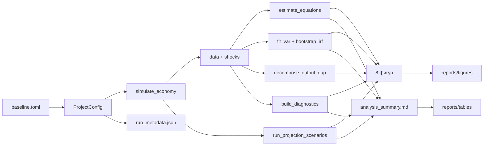

# MacroCanvas: архитектура проекта

Документ описывает слоистую архитектуру MacroCanvas, контракты данных между модулями, оркестрацию пайплайна и точки расширения. Он дополняет раздел 6 README и предназначен для разработчика, который будет сопровождать или расширять код.

---

## 1. Принципы архитектуры

| Принцип | Следствие в коде |
| --- | --- |
| **Однонаправленные зависимости** | `config → data → models → analytics → viz → reporting → pipeline`; нижние слои не импортируют верхние |
| **Чистые функции на границах** | Генератор, оценщики и декомпозиция возвращают dataclass-результаты, а не пишут файлы |
| **Побочные эффекты — только в оркестраторе** | Запись CSV/PNG/MD сосредоточена в `pipeline.py` и `viz/style.py::save_figure` |
| **Явные контракты** | Входы/выходы описаны типами и таблицами схем; пропуски и пропущенные колонки валидируются с понятными ошибками |
| **Детерминизм** | Все случайные процессы принимают seed; ни один модуль не использует глобальный `np.random` |
| **Тестируемость без I/O** | Каждый слой можно вызвать в тесте на маленьком DataFrame без файловой системы |
| **Конфигурация как данные** | Калибровка живёт в TOML и в frozen dataclass'ах, а не в литералах по коду |

---

## 2. Слоистая схема

```
┌──────────────────────────────────────────────────────────────────────┐
│  CLI (cli.py)                                                        │
│  argparse → ProjectConfig → run_pipeline → печать сводки             │
└───────────────────────────────┬──────────────────────────────────────┘
                                │
┌───────────────────────────────▼──────────────────────────────────────┐
│  Оркестрация (pipeline.py)                                           │
│  6 стадий; единственное место, где пишутся файлы результатов         │
└───┬──────────┬──────────┬──────────┬──────────┬──────────┬───────────┘
    │          │          │          │          │          │
┌───▼───┐ ┌────▼────┐ ┌───▼────┐ ┌───▼─────┐ ┌──▼─────┐ ┌──▼─────────┐
│ config│ │  data   │ │ models │ │analytics│ │  viz   │ │ reporting  │
│ TOML  │ │generator│ │OLS/VAR/│ │decomp/  │ │8 фигур │ │ Markdown + │
│ paths │ │         │ │scenario│ │diagnos. │ │        │ │ JSON       │
└───────┘ └─────────┘ └────────┘ └─────────┘ └────────┘ └────────────┘
```

Зависимости внутри пакета:

```
config.py
  ↑
data/generator.py ──► models/scenarios.py
  ↑                        ↑
models/ols.py ◄────────────┘
models/var.py
  ↑
analytics/decomposition.py, analytics/diagnostics.py
  ↑
viz/style.py, viz/utils.py
  ↑
viz/dashboard.py, viz/model_map.py, viz/charts.py
  ↑
reporting.py ◄── pipeline.py ──► cli.py
```

---

## 3. Каталог модулей

### 3.1. `config.py`

**Ответственность:** типизированная конфигурация, валидация, канонические пути.

| Публичный объект | Назначение |
| --- | --- |
| `ModelParameters` | 33 параметра модели; frozen dataclass; `validate()` проверяет экономические ограничения |
| `SimulationConfig` | seed, periods, burn_in, start_period; `validate()` |
| `EstimationConfig` | HAC-лаги, порядок VAR, число репликаций/путей, горизонт, projection_seed |
| `ProjectConfig` | агрегат трёх секций; `from_toml()`, `to_dict()`, `validate()` |
| `ProjectPaths` | `data_raw`, `data_processed`, `figures`, `tables`, `reports`; `ensure()` |
| `DEFAULT_CONFIG_PATH` | путь к `configs/baseline.toml` относительно пакета |

**Валидация.** Проверяются диапазоны персистентностей `[0, 1)`, неотрицательность σ и коэффициентов, строгая положительность `inflation_response`, `periods ≥ 40`, `burn_in ≥ 20`, `var_lags ∈ [1, 8]`, `bootstrap_reps ≥ 50`, `projection_paths ≥ 100`, формат `YYYYQn`. Неизвестные секции и ключи TOML отклоняются.

**Почему frozen:** калибровка не должна меняться в середине пайплайна; CLI создаёт новые экземпляры через `dataclasses.replace`.

### 3.2. `data/generator.py`

**Ответственность:** симуляция экономики и структурных шоков.

| Публичный объект | Назначение |
| --- | --- |
| `SimulationResult` | `data` (144 × 24), `shocks` (144 × 9), `parameters`, `seed`, `metadata` |
| `ar1_process(n, persistence, innovation_sd, rng, mean=0)` | стационарный AR(1) из безусловного распределения |
| `simulate_economy(simulation, parameters)` | полный DGP |

**Внутренняя структура:**

- `_allocate(seed, 9)` — `SeedSequence.spawn` → девять независимых `Generator`;
- один цикл `for t in range(n_total)` с явными уравнениями (1)–(9);
- после цикла — производные ряды, burn-in, `PeriodIndex`, ребейз индексов.

**Контракт:** на выходе гарантированы 24 колонки, отсутствие NaN в сохранённой выборке, точная IS-идентичность, `recession ∈ {0, 1}`.

### 3.3. `models/ols.py`

**Ответственность:** OLS с HAC-инференцией и частичные регрессии.

| Публичный объект | Назначение |
| --- | --- |
| `OLSResult` | параметры, HAC-ошибки, t, p, ковариация, остатки, fitted, R², adj. R², σ |
| `fit_ols(y, x, name, hac_lags, add_constant)` | оценка на общей полной выборке (dropna) |
| `EquationEstimate` | уравнение + фокус-коэффициент + метаданные для визуализации |
| `estimate_equations(data, hac_lags)` | четыре уравнения |
| `estimates_table`, `coefficient_table`, `collect_residuals` | tidy-таблицы для CSV |

**Детали реализации:**

- `np.linalg.lstsq` вместо обращения матриц;
- `pinv(X'X)` для устойчивости к коллинеарности;
- HAC: ядро Бартлетта, лаг `L`, поправка `n/(n−k)`, симметризация;
- p-значения через `math.erfc(|t|/√2)`;
- `partial_data()` реализует FWL: остатки y и фокуса после проекции на контроли.

### 3.4. `models/var.py`

**Ответственность:** reduced-form VAR(p), Холецкий, IRF, residual bootstrap.

| Публичный объект | Назначение |
| --- | --- |
| `VARResult` | коэффициенты, Σ, остатки, fitted, companion, корни, `is_stable`, `cholesky`, `history` |
| `fit_var(data, variables, lags)` | поэквеционный OLS |
| `compute_irf(var_result, shock, horizon)` | ортогонализованные отклики, нормализация impact = 1 |
| `IRFResult` | точечные IRF + квантили 5/16/50/84/95 % + `tidy()` |
| `bootstrap_irf(data, variables, shock, ...)` | residual bootstrap с отбраковкой нестабильных репликаций |

**Алгоритм бутстрапа:**

```
для r = 1…R:
    симулировать VAR из начальной истории, ресэмплируя целые векторы остатков
    переоценить VAR
    если нестабилен или Σ нефинитна → отбросить
    вычислить IRF
вернуть квантили по R стабильным репликациям
```

Ограничение `reps ≥ 20`, максимум попыток `8R`; если стабильных меньше `max(20, R/2)` — `RuntimeError`.

### 3.5. `models/scenarios.py`

**Ответственность:** структурные проекции и контрфактический сценарий.

| Публичный объект | Назначение |
| --- | --- |
| `ProjectionBundle` | `paths` (long), `bands`, `effects`, `horizon_index` |
| `run_projection_scenarios(result, parameters, horizon, n_paths, seed, tightening_pp, tightening_quarters)` | базовый и альтернативный сценарии |

**Детали:**

- `_draw_innovations` — один набор шоков на оба сценария (CRN);
- `_simulate_paths` — векторная симуляция по путям (numpy-массивы длины `n_paths`);
- старт из последнего наблюдения выборки;
- `_bands` — квантили 5/16/50/84/95 % через `groupby.quantile` + `pivot`;
- `effects` — медианы по сценариям и их разность.

**Контракт `effects`:** колонки `scenario`-независимые: `horizon`, `quarter`, `variable`, `baseline_median`, `tightening_median`, `difference`.

### 3.6. `analytics/decomposition.py`

**Ответственность:** точная бухгалтерская декомпозиция IS.

| Публичный объект | Назначение |
| --- | --- |
| `COMPONENT_COLUMNS`, `COMPONENT_LABELS` | шесть компонентов и русские подписи |
| `decompose_output_gap(data, parameters)` | DataFrame с компонентами, суммой и ошибкой идентичности |
| `contribution_table` | long-формат для экспорта |
| `latest_waterfall` | последний квартал, сортировка по модулю вклада, кумулятивные суммы |
| `contribution_summary` | среднее, σ, min/max, максимальный модуль вклада, RMSE идентичности |

Шок вычисляется как остаток: `xₜ − Σ(пять компонентов)`. Это делает идентичность устойчивой к изменениям в хранении шоков.

### 3.7. `analytics/diagnostics.py`

**Ответственность:** описательная статистика и диагностика.

| Публичный объект | Назначение |
| --- | --- |
| `SampleStatistics` | таблица статистик, корреляции, рецессии, остаточная диагностика |
| `descriptive_statistics` | 12 переменных: n, mean, sd, min, p25, median, p75, max |
| `correlation_matrix` | 9 переменных, русские подписи |
| `find_recession_episodes` | пробеги `recession == 1` длительностью ≥ 2 |
| `residual_diagnostics` | R², σ остатков, ACF(1) |
| `correlation_extremes` | top-N пар по абсолютной корреляции для текстового отчёта |

### 3.8. `viz/`

| Модуль | Фигуры | Ключевые функции |
| --- | --- | --- |
| `style.py` | — | `COLORS`, `apply_style`, `save_figure`; `matplotlib.use("Agg")` |
| `utils.py` | — | `quarter_axis`, `recession_spans`, `zero_line`, `add_last_value`, `add_footer`, `add_suptitle`, `draw_fan`, `fan_legend` |
| `dashboard.py` | 01 | `plot_macro_dashboard(data, seed, episodes, path)` |
| `model_map.py` | 02 | `plot_model_map(path)` — блок-схема трансмиссии |
| `charts.py` | 03–08 | `plot_estimated_relations`, `plot_irf`, `plot_projection_fan`, `plot_policy_scenario`, `plot_shock_decomposition`, `plot_correlation_map` |

**Соглашения оформления:** фон `#F7F5F0`, белые панели, тёмно-синий/бирюзовый/золотой/красный акценты, заголовок + подзаголовок, footer с методологической оговоркой, `dpi = 200`, `bbox_inches = "tight"`.

### 3.9. `reporting.py`

**Ответственность:** автоматический Markdown-отчёт.

| Публичный объект | Назначение |
| --- | --- |
| `_markdown_table` | GFM-таблица без зависимости от `tabulate` |
| `write_analysis_report(...)` | 7 разделов: выборка, оценки, VAR/IRF, проекция, сценарий, диагностика, артефакты |

Отчёт всегда включает дисклеймер и проверку ошибки IS-идентичности, пересчитанную независимо от `decomposition.py`.

### 3.10. `pipeline.py`

**Ответственность:** оркестрация шести стадий и запись всех артефактов.

| Стадия | Действие | Артефакты |
| --- | --- | --- |
| 1/6 | симуляция | `data/raw/synthetic_economy.csv`, `structural_shocks.csv`, `data/processed/analysis_dataset.csv` |
| 2/6 | OLS/HAC | таблицы оценок |
| 3/6 | VAR + bootstrap | IRF-таблицы |
| 4/6 | проекции, декомпозиция, диагностика | таблицы проекций/декомпозиции/статистик |
| 5/6 | графики | 8 PNG |
| 6/6 | отчёт и метаданные | `analysis_summary.md`, `run_metadata.json` |

`PipelineResult` — frozen dataclass со всеми объектами и путями; используется CLI для печати сводки и тестами для проверки полноты.

### 3.11. `cli.py`

**Ответственность:** argparse-интерфейс, переопределения конфига, обработка ошибок.

- поиск `configs/baseline.toml` в текущем каталоге, если `--config` не задан;
- `dataclasses.replace` для `--seed`, `--periods`, `--var-lags`;
- `--output-dir` задаёт корень проекта;
- при исключении — лог и код возврата 1 (с traceback, если не `--quiet`);
- при успехе — сводка на русском.

---

## 4. Контракты данных

### 4.1. `SimulationResult.data` (144 × 24)

| Группа | Колонки |
| --- | --- |
| Эндогенные | `output_gap`, `inflation`, `inflation_expectations`, `real_rate_ex_ante`, `unemployment_gap`, `policy_rate` |
| Рынок труда | `unemployment`, `unemployment_gap` |
| Экзогенные | `external_demand_gap`, `fiscal_impulse`, `oil_price_shock`, `financial_stress` |
| Потенциал | `potential_growth`, `potential_growth_rate`, `log_potential`, `log_output` |
| Производные | `gdp_growth`, `inflation_yoy`, `price_index`, `real_policy_rate`, `real_gdp`, `real_gdp_growth_yoy`, `gdp_index`, `potential_gdp_index`, `recession` |

Индекс — `pd.PeriodIndex(freq="Q")` с именем `quarter`.

### 4.2. `SimulationResult.shocks` (144 × 9)

`output_gap_shock`, `inflation_shock`, `unemployment_shock`, `policy_shock`, `external_demand_shock`, `fiscal_shock`, `oil_shock`, `financial_stress_shock`, `potential_growth_shock`.

### 4.3. `ProjectionBundle`

| Поле | Формат |
| --- | --- |
| `paths` | long: `scenario`, `path_id`, `horizon`, `quarter`, `variable`, `value` |
| `bands` | wide по квантилям: `scenario`, `horizon`, `quarter`, `variable`, `q05`, `q16`, `q50`, `q84`, `q95` |
| `effects` | `horizon`, `quarter`, `variable`, `baseline_median`, `tightening_median`, `difference` |
| `horizon_index` | `PeriodIndex` будущих кварталов |

### 4.4. Таблицы отчёта (15 CSV)

| Файл | Строки | Содержимое |
| --- | --- | --- |
| `estimated_equations.csv` | все коэффициенты × 4 уравнения | β, HAC SE, t, p, R², n |
| `focus_coefficients.csv` | 4 | только фокус-коэффициенты |
| `var_coefficients.csv` | 4 уравнения × 5 регрессоров | коэффициенты VAR |
| `impulse_responses.csv` | 4 переменные × 13 горизонтов | отклик + квантили |
| `projection_effects.csv` | 6 переменных × 12 горизонтов = 72 | медианы базового и альтернативного сценариев |
| `projection_bands.csv` | 6 × 12 × 2 = 144 | квантили 5/16/50/84/95 % |
| `shock_decomposition.csv` | 143 × 10 | компоненты + сумма + ошибка |
| `shock_contributions_long.csv` | 143 × 6 | long-формат |
| `contribution_summary.csv` | 6 | сводка по компонентам |
| `latest_waterfall.csv` | 6 | последний квартал |
| `descriptive_statistics.csv` | 12 | описательные статистики |
| `correlations.csv` | 9 × 9 | матрица корреляций |
| `recession_episodes.csv` | 4 | эпизоды |
| `residual_diagnostics.csv` | 4 | R², σ, ACF(1) |
| `parameters.csv` | 1 × 33 | калибровка |

---

## 5. Поток выполнения



Стадии логируются через `logging` (`Stage 1/6` … `Stage 6/6`). Время полного прогона baseline — 30–60 секунд на потребительском ноутбуке; доминируют bootstrap (300 репликаций VAR с 143 наблюдениями) и рендеринг восьми фигур в 200 dpi.

---

## 6. Обработка ошибок и валидация

| Уровень | Механизм | Пример |
| --- | --- | --- |
| Конфиг | `ValueError` с именем поля и значением | `output_gap_persistence must lie in [0, 1); got 1.2` |
| TOML | отказ при неизвестных секциях/ключах | `Unknown key(s) in [parameters]: ['foo']` |
| Данные | проверка обязательных колонок | `Missing columns for estimation: ['output_gap']` |
| OLS | проверка числа наблюдений | `insufficient complete observations` |
| VAR | проверка стабильности/размера | `Not enough observations to estimate the VAR` |
| Бутстрап | отбраковка и порог | `Only 12 stable bootstrap replications were generated` |
| CLI | перехват исключений → код 1 | сообщение в лог, traceback при не-`--quiet` |
| Тесты | pytest | 22 теста, включая негативные сценарии |

Принцип: ошибка должна называть **поле**, **ожидание** и **фактическое значение**, а не падать с `KeyError` в глубине pandas.

---

## 7. Тестовая стратегия

| Уровень | Файл | Идея |
| --- | --- | --- |
| Конфиг | `test_config.py` | загрузка baseline, отказ неизвестных ключей, отказ невалидных значений, создание путей |
| Генератор | `test_generator.py` | детерминизм seed, чувствительность к seed, форма/колонки, точная идентичность, единицы |
| Оценка | `test_estimation.py` | восстановление известной линейной модели, знаки и значимость, FWL, стабильность VAR, порядок квантилей, dropna |
| Сценарии | `test_scenarios.py` | форма полос, CRN-воспроизводимость, направление эффекта, водопад |
| Пайплайн | `test_pipeline.py` | smoke-тест: полный прогон в `tmp_path`, наличие всех файлов |

Тесты используют уменьшенные конфигурации (например, `periods=80`, `bootstrap_reps=60`), чтобы набор выполнялся за секунды. `pyproject.toml` задаёт `pythonpath = ["src"]`, поэтому `pytest` работает без установки пакета.

---

## 8. Воспроизводимость на уровне архитектуры

1. **Seed как явный аргумент.** Ни один модуль не читает глобальный random state.
2. **`SeedSequence`.** Иерархия потоков: корень → 9 детей; сценарии — отдельный `default_rng(projection_seed)`.
3. **Frozen конфиги.** Нет мутаций калибровки во время выполнения.
4. **`Agg` backend.** Графики не зависят от наличия дисплея.
5. **Детерминированные квантили.** `np.quantile` на фиксированных массивах.
6. **Метаданные.** `run_metadata.json` фиксирует конфиг, seed, время и инвентарь артефактов.

---

## 9. Точки расширения

### 9.1. Новый структурный шок

1. `config.py::ModelParameters` — поля персистентности и σ + валидация.
2. `generator.py` — новый поток в `_allocate`, генерация, включение в уравнение, колонка в `shocks`.
3. `scenarios.py::_draw_innovations` — инновации для проекций.
4. `configs/baseline.toml` — значения.
5. Тест на воспроизводимость и на форму `shocks`.

### 9.2. Новое уравнение

1. `ols.py::estimate_equations` — спецификация, фокус, `expected_sign`, `economic_note`.
2. `charts.py::plot_estimated_relations` — панель (сетка).
3. `reporting.py` — строка в таблице оценок (автоматически, если добавлено в `estimates`).
4. Тест на знак и значимость.

### 9.3. Альтернативная идентификация VAR

1. `var.py` — новая функция `compute_irf_*` с матрицей ограничений.
2. `pipeline.py` — выбор схемы через параметр конфига.
3. Тест на согласованность impact-отклика.

### 9.4. Новый сценарий

1. `scenarios.py` — параметризовать `policy_offset` (например, перманентное ужесточение, снижение ставки, ELB-эпизод).
2. `charts.py` — панель сравнения.
3. `reporting.py` — текстовое резюме эффекта.

### 9.5. Новая фигура

1. `charts.py` — функция `plot_*` по шаблону: `apply_style` → `add_suptitle` → панели → `add_footer` → `save_figure`.
2. `pipeline.py::_build_figure_files` — имя файла.
3. `pipeline.py` — вызов.
4. README — описание и встраивание.

---

## 10. Соглашения кода

- Python ≥ 3.11, `from __future__ import annotations`, современные аннотации (`list[str]`, `str | Path`).
- Frozen dataclass'ы `slots=True` для всех результатов и конфигов.
- Имена переменных кода — английские; подписи графиков и отчёта — русские.
- Форматирование: `ruff`, длина строки 100 (конфиг в `pyproject.toml`).
- Никаких глобальных состояний, кроме `matplotlib` rcParams в `apply_style`.
- Docstring'и — краткие, в императивном наклонении; модульные — с описанием единиц и тайминга.
- Числовые допущения фиксируются в тестах, а не «на глаз».

---

## 11. Известные архитектурные компромиссы

| Компромисс | Причина | Последствие |
| --- | --- | --- |
| Ручные OLS/VAR | прозрачность и контроль формул | нет автоматических диагностик (RESET, ARCH, критериев выбора лага) |
| Проекции через DGP | точный контроль сценария | сценарии не учитывают неопределённость оценённых параметров |
| Один модуль `charts.py` | простота навигации | файл ~600 строк; при росте числа фигур стоит разбить по темам |
| Русские подписи в коде визуализации | требования отчёта | затрудняет повторное использование в англоязычных проектах |
| Нет кэширования симуляций | простота и воспроизводимость | повторный прогон всегда пересчитывает всё с нуля |
| `pinv` вместо `inv` | устойчивость к коллинеарности | скрывает идеальную мультиколлинеарность; в тестах она не встречается |

---

## 12. Контрольный список сопровождения

- [ ] `pytest -q` — 22 теста проходят.
- [ ] `python -m macrocanvas --config configs/baseline.toml` завершается кодом 0.
- [ ] В `reports/figures/` — 8 PNG, в `reports/tables/` — 15 CSV.
- [ ] `run_metadata.json` содержит полный конфиг и инвентарь.
- [ ] Ошибка IS-идентичности в отчёте — `0.00e+00`.
- [ ] `docs/images/` синхронизирован с итоговыми графиками.
- [ ] README и docs не содержат устаревших чисел.
